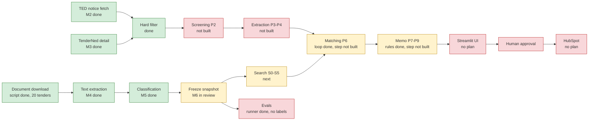

# Status: Tender Copilot

Last updated: Wed 25 Nov 2026, 12:15. Commit only when Arthur asks (or the `/build` supervisor, after a reviewer PASS).

## In one line

The core modules are done and reviewed. The manual snapshot is downloaded (20 tenders, 346 files), and text extraction and classification are built. The freeze script (M6) is in review. Search, the pipeline steps that write memos, the database, the UI and the CRM are not built yet. The live model path works (25 Nov).

## Pipeline map

## Done

**Core (13–16 Nov, reviewed 16 Nov)**
- Hard filter (`pipeline/filter.py`), schemas, citation verifier, recommendation rules (`pipeline/memo.py`)
- LLM gateway (`llm/`): redaction, validation with one retry, logging, prices, Anthropic and Mistral adapters
- Agent loop and five tools (`agent/`), matching step for one requirement (`pipeline/match.py`)
- Prompts v1 and the prompt registry
- Eval runner skeleton with cost cap and dry run (`evals/`)
- TED XML parser with 11 redacted fixtures
- Implementation plans: `documents.md`, `database.md`, `pipeline.md`, `search.md`, `manual_snapshot.md`

**This week (23–25 Nov)**
- 23 Nov: all plan decisions recorded (F13, DD1–DD11, SD1–SD5); S6 checkpoint missed, so v1 uses a manual snapshot
- Build loop: `/build` supervisor with Sonnet builder and Opus reviewer (`.claude/`), commits reviewed steps itself, never pushes
- M0–M3: TenderNed fixtures, HTTP client, TED notice fetch, TenderNed detail fetch (`d91f249`)
- Final 20 tenders fixed (round-robin: 9 × CPV 79, 7 × CPV 72, 4 × CPV 48; Jan–Jun); no replacements needed
- Download: 346 files for the 20 tenders by script, no failures (`5520275`, reviewed after 2 fix rounds)
- M4 text extraction for PDF, DOCX and XLSX (`f8f9e87`)
- M5 rule-based classification with DD5 amendment (`16b3821`)
- Live gateway call confirmed 25 Nov: claude-haiku-5-5, status ok, $0.000090, redaction verified before send
- Tests: 1493 passing; lint clean

**Not pushed yet:** commits after `d47e072` are local only.

## In progress

- **M6 freeze script** (ZIP unpacking within limits, tender list from `data/snapshot_ids.txt`): built, in review
- **Next run:** DD5 amendment 2 (UEA forms before the guideline rule) and the live freeze of the 20 tenders (needs network approval, at most 60 requests)

## Left to do

**Before Fri 27 Nov (Sia application)**
1. Finish M6 and freeze the snapshot; check it opens with `open_snapshot`
2. Push all local commits
3. Run 2: search over the snapshot (`search.md` S0–S5; dependencies and the BGE-M3 download need approval)
4. Run 3: pipeline on the snapshot (`pipeline.md` P0–P12; PD1–PD15 need answers), with one live run on one tender
5. Arthur: company KB files (PD6), first eval labels in `evals/datasets/`
6. First eval run: `make evals MAX_COST=10` on about 20 tenders
7. Apply to Sia

**Before Fri 4 Dec (evals done)**
- Database B0–B10 (needs Docker Desktop)
- Daily job P13–P14 and indexing S6–S8
- Automated document fetcher D1–D10, including cancellations (D8, via `isVroegtijdigBeeindigd` / `isGegund`)
- Full labels (60 relevance, 15 knock-out, 30 retrieval) and rubric
- Model comparison (Mistral, OpenAI) and one measured improvement

**Before Fri 11 Dec (deployed)**
- Plans and builds for Streamlit UI, HubSpot (account and token needed) and deployment on one VM
- Dockerfile to `uv sync --frozen`, copy `prompts/` and `COMPANY.md`, image build in CI
- README: results, limits (manual snapshot, redaction limits), PyMuPDF licence note, GDPR and AI Act section
- Demo video, CV update, rebuild the agent loop from memory

**Housekeeping**
- Fix `/build` commit rule so `docs/` files the supervisor changes are committed
- Review follow-ups in `docs/BUILD_LOG.md` (open low findings for M4, M5, the download scripts)
- Older follow-ups: payload purge scheduling, cost-cap docstring, `agent/fakes.py` out of the package, duplicate `.env` parser in scripts
- `docs/NEXT.md` is out of date (13 Nov): replace with this file or remove

## Open decisions (Arthur)

| # | Question | Needed for | Recommendation |
|---|---|---|---|
| PD1–PD15 | Pipeline behaviour (map units, token budget, failures, notice-only memo, KB location, limitations codes, confidence rule, daily cap, CPV labels, KB evidence check, deadline time) | Run 3 | Read `pipeline.md` section 2; accept or flag by number |
| DD5-2 | UEA forms checked before the guideline rule | Freeze run | Accept |
| DB section 2 | Database plan decisions | Run 4 | Read when run 4 is near |
| Q8 | One memo per tender or per lot | Memo | Open; interim R9 (`lot_specific_knockout`) |
| Q12 | Daily Stage 2 cost cap | Daily job | After first measurements |
| E1 | `min_knockout_recall = 0.90` | Eval gate | Confirm after first real run |
| — | Let the loop push, or keep push manual | Build loop | Keep manual |

## External and blocked

- **TenderNed terms (Q1):** email to functioneel beheer about automated download and storage, reply pending
- **Docker Desktop:** not installed; needed for the database runs
- **Anthropic API:** credit working since 25 Nov; set a monthly spending limit in the Console
- **Old credentials:** remove the plaintext TenderNed password from `APInet/call.py` outside the repo

## Key dates

| Date | What |
|---|---|
| Wed 25 Nov | M6, live freeze, start search (run 2) |
| Thu 26 Nov | Pipeline run 3, first live memo |
| Fri 27 Nov | First eval run; apply to Sia |
| Fri 4 Dec | Database, daily job, fetcher, evals and comparison done |
| Fri 11 Dec | Deployed demo, README, demo video, CV |
